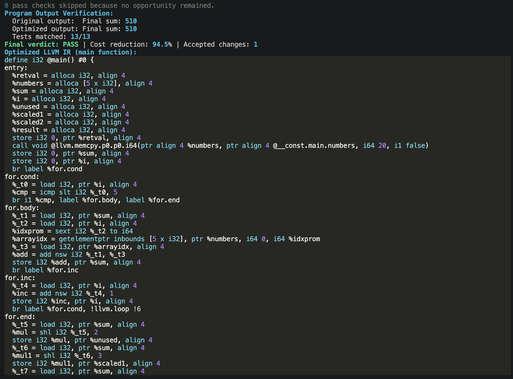
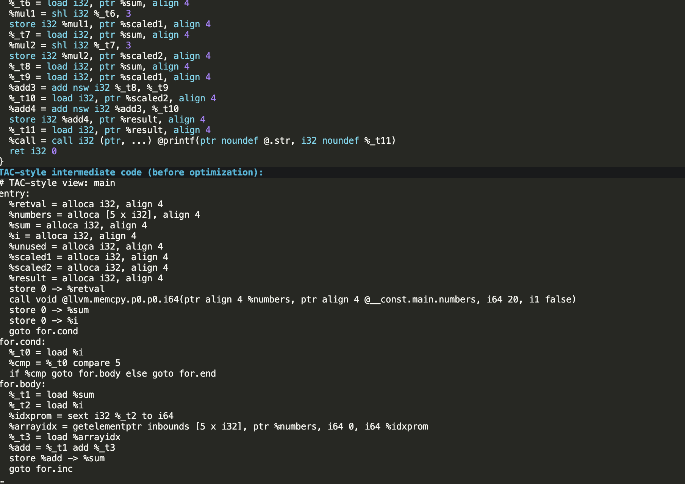
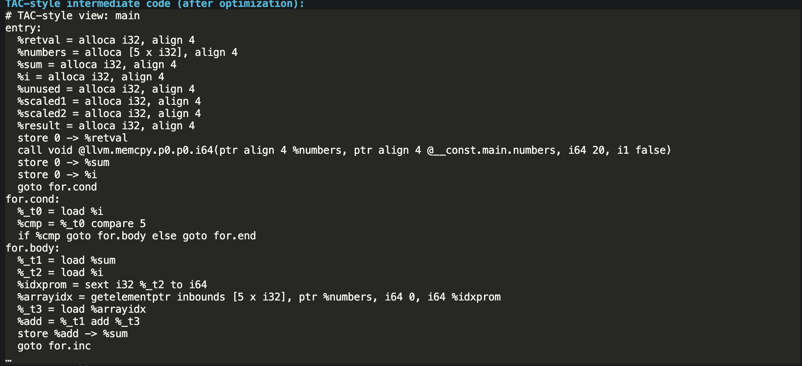
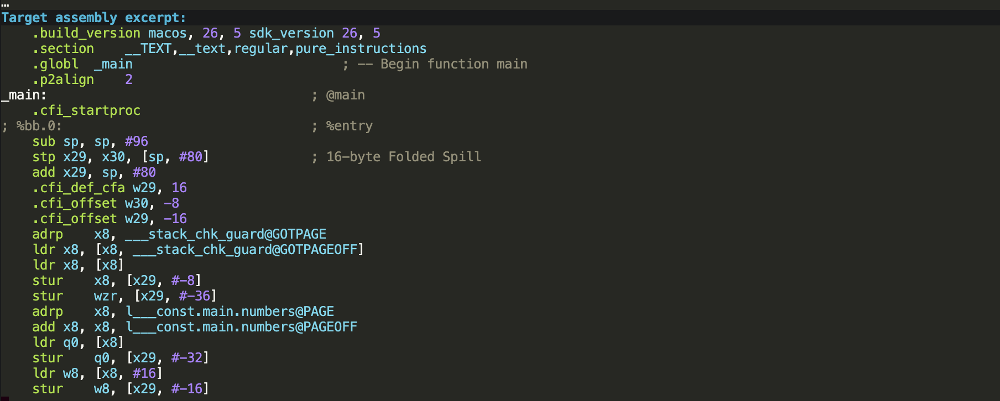

# Automated LLM/Agent-Guided Compiler Code Optimization

This project implements a fail-closed compiler-optimization agent for C programs. It uses LLVM IR analyses and optimization passes; an optional Ollama LLM can recommend passes, but it never has authority to commit a transformation.

## One-command presentation demo

```bash
python3 -m pip install -r requirements.txt
python3 main.py
```

The default command opens a menu: choose to paste your own C program, run a quick 10-program dataset demo, or run the full 500-program dataset. For pasted C, type `END` alone on the final line; it then compiles and runs the full autonomous loop immediately.

For the dataset experiment:

```bash
python3 main.py --run-dataset --dataset-limit 10
```

Use the command without `--dataset-limit` for the complete reproducible **500-program** experiment. The first run creates `dataset/programs/`. Results are saved under `reports/dataset/`:

- `REPORT.md` — aggregate metrics
- `summary.json` — machine-readable metrics and every program outcome
- `logs/*.json` — full accept/reject decision log for each program
- `figures/` — Sankey, per-pass outcomes, pie chart, cost-over-iterations, scatter plot, and category heatmap

For a single existing source file:

```bash
python3 main.py examples/05_strength_reduction.c --benchmark --diff
```

## Paste-C-code interactive demo

```bash
ollama pull qwen2.5-coder:3b   # only needed for Qwen guidance
python3 main.py --interactive --llm --model qwen2.5-coder:3b
```

Paste a full C program, then enter `END` on its own line. The terminal prints every proposed pass, verification verdict, cost before/after, accept/reject result, final LLVM IR, and writes `reports/interactive_decision_log.json`. `--llm` is optional; it asks local Ollama/Qwen to order the available transformations, while the verifier remains the authority.

The interactive result also displays the original program output next to the optimized program output and the number of matching differential tests.

After choosing LLM guidance, the interactive flow can also show optional **TAC-style intermediate code before/after optimization** and a target-assembly excerpt. This is useful for demonstrating intermediate-code generation and code generation topics in a compiler course. See [SYLLABUS_COVERAGE.md](docs/SYLLABUS_COVERAGE.md).

## Architecture

1. **Code analysis specialist**: CFG, dominator, loop, def-use, and memory analyses discover opportunities.
2. **Optimization specialist**: rule passes (or optional Ollama proposals) suggest transformations.
3. **Orchestrator**: tests one candidate pass at a time and repeats to a fixed point.
4. **Verification module**: compiles each candidate and performs differential testing across 13 inputs: a default run, edge cases, and reproducible random values. A compile error, timeout, exit-code change, or output mismatch rejects it.
5. **Cost evaluator**: scores `instruction_count + 3 × expensive_arithmetic_ops + temporary_registers + 10 × mean_execution_ms`. A verified candidate is still rejected unless this score decreases.

The acceptance invariant is: **accepted = verified correct AND lower cost**. Since the current IR is updated only after verification succeeds, an incorrect transformation cannot be accepted.

## Dataset

The generator creates 500 small, deterministic C programs:

| Category | Count |
|---|---:|
| Arithmetic-only | 60 |
| Nested expressions | 60 |
| Repeated expressions | 60 |
| Dead code | 60 |
| Loops | 80 |
| Conditionals | 80 |
| Mixed opportunities | 100 |

## Demo Screenshots

The interactive demonstration preserves program output while showing the accepted optimization decisions and compiler artifacts.

### 1. Output Verification and Optimized LLVM IR



### 2. LLVM IR and TAC-Style View Before Optimization



### 3. TAC-Style Intermediate Code After Optimization



### 4. Target Assembly Excerpt



## Presentation notes

Open the folder in VS Code, use its integrated terminal, install requirements once, then run the quick command above. Open `reports/dataset/REPORT.md` and the generated PNGs after the command completes. For the full run, omit the limit; it takes longer because every candidate must be compiled and differentially tested.
